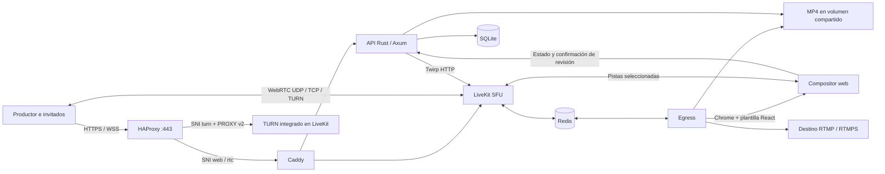

# Arquitectura

## Estado y autorización

Una instancia de aplicación gestiona un estudio y una sala de LiveKit. SQLite conserva una instantánea JSON transaccional del agregado de estudio, además de los ajustes de autenticación. Esta decisión reduce las migraciones de la primera versión; no es un diseño para múltiples réplicas del backend. `rusqlite` sustituye SQLx, conservando SQLite, WAL y sentencias parametrizadas. La estructura pública está documentada en OpenAPI.

El backend serializa comandos de producción y actualiza una revisión monotónica del programa. Una revisión desactualizada devuelve 409. Las notificaciones WebSocket solo señalan que hay cambios: cada cliente obtiene una instantánea autenticada. Hay sondeo de respaldo y reconexión del WebSocket.

Invitaciones aleatorias se guardan como hashes; la respuesta inicial es la única que revela el enlace completo. La previsualización de invitados usa getUserMedia local. La sala de espera no recibe JWT multimedia. El administrador tiene controles de estudio; los invitados solo consultan estado y solicitan un token después de ser admitidos.

El renderer recibe una credencial aleatoria independiente por directo, además del JWT de lectura generado por Egress. Su credencial solo autoriza leer la composición y confirmar revisiones de ese directo activo. Se deshabilita la suscripción automática y se suscriben explícitamente pistas autorizadas por fuente e identidad. El componente Stage solo monta elementos de audio permitidos y los desmonta al retirarlos del programa. No se utiliza un reproductor global de audio de la sala dentro del compositor.

Los micrófonos de todas las identidades seleccionadas siguen al aire en modo protagonista, aunque solo se vea su cámara principal. El audio de pantalla requiere habilitación explícita y la composición de pantalla. Los participantes admitidos pueden conversar entre sí fuera del programa; este espacio no se presenta como conversación privada entre productor e invitado.

## Emisión y reconciliación

StartEgress recibe una fuente TemplateSource y dos salidas: un archivo MP4 y un StreamOutput RTMP. La codificación H.264/AAC es compartida. No existe una salida RTMP desde el navegador del productor.

Se persiste la sesión antes de llamar al servicio externo. Una respuesta ambigua produce estado uncertain y bloquea otros inicios. ListEgress recupera el trabajo mediante su identificador o la ruta única del archivo en `egress.outputs`. Una consulta satisfactoria sin trabajo correspondiente durante más de 90 segundos marca la solicitud como fallida. Un error de conectividad conserva la incertidumbre.

La reconciliación consulta cada cinco segundos el estado de Egress y participantes. Webhooks firmados verifican emisor, firma, expiración y SHA-256 del cuerpo original; no deciden estados terminales de emisión basándose en el orden de entrega. La desaparición de una pantalla se procesa por webhook y también por reconciliación.

Se mantiene una grabación independiente por sesión. Solo un EGRESS_COMPLETE con archivo presente se ofrece como descarga finalizada. Los errores mantienen el archivo como interrumpido; no se promete integridad tras un crash del compositor o del host.

Los timeouts de API son de 20 segundos. Un servicio multimedia caído puede retrasar los controles de producción o impedir una parada ordenada: el panel debe mostrar el fallo, y la recuperación operativa debe comprobar LiveKit/Egress antes de reiniciar otra emisión. Los avisos y límites de disco son preventivos, no una garantía contra fallos de almacenamiento.

## Versiones y red

- LiveKit server v1.13.11, Egress v1.15.0 y SDK navegador 2.23.0: versiones fijadas; compatibilidad audiovisual pendiente de ensayo en VPS.
- Axum 0.8.9, Tokio 1.53.3, React 19.3.0; dependencias transitorias fijadas en Cargo.lock y bun.lock.
- WebSocket de control con tokio-tungstenite 0.28 y upgrade HTTP de Hyper. Esto permite compilar con las dependencias disponibles en caché.
- HAProxy inspecciona SNI sin terminar TLS. TURN recibe PROXY v2 para conservar la dirección del invitado. Caddy termina HTTPS para el panel y la señalización.
- La versión fijada de LiveKit anuncia TURN/TLS en el puerto público 443 aunque escuche internamente en 5349. HAProxy enruta ese dominio a 5349.
- Caddy obtiene el certificado TURN mediante HTTP-01 y lo comparte en modo lectura con LiveKit. La primera adquisición y posteriores recargas de LiveKit forman parte de la operación.

## Fuentes técnicas

Documentación consultada el 1 de noviembre de 2026:

- [API Egress unificada](https://docs.livekit.io/reference/other/egress/api/): StartEgress requiere servidor autohospedado 1.13.5 o posterior.
- [Plantillas de compositor](https://docs.livekit.io/transport/media/ingress-egress/egress/custom-template/).
- [Requisitos de Egress](https://docs.livekit.io/transport/self-hosting/egress/): al menos 4 CPU y 4 GB por instancia recomendados por el proveedor.
- [Puertos y firewall](https://docs.livekit.io/transport/self-hosting/ports-firewall/).
- [Pantalla y audio compartidos](https://docs.livekit.io/transport/media/screenshare/).
- [Protocolo Egress](https://github.com/livekit/protocol/blob/main/protobufs/livekit_egress.proto).
- [TURN anunciado y tokens en LiveKit v1.13.11](https://github.com/livekit/livekit/blob/v1.13.11/pkg/service/roommanager.go).
- [Implementación TURN y PROXY protocol](https://github.com/livekit/livekit/blob/v1.13.11/pkg/service/turn.go).

Alternativas estudiadas: mediasoup-rust proporciona control sobre un SFU C++ pero exige integrar composición y exportación; str0m permite construir un motor WebRTC en Rust con un esfuerzo mucho mayor. MediaMTX resulta útil para encaminamiento de protocolos, pero no sustituye por sí solo el estudio multiparte con escenas. Se eligió LiveKit por ajuste al producto solicitado.

## Biblioteca y composición del programa

`Program` mantiene compatibilidad con datos previos mediante valores por defecto para contenido, reproducción y estilo. Las fuentes `screen` y `media_asset` son mutuamente excluyentes. Una fuente de contenido tiene modo lateral, flotante o completo; la composición de cámaras calcula rectángulos 16:9 centrados para 1–6 participantes.

La biblioteca vive en `DATA_DIR/assets`; sus metadatos se guardan junto al agregado de SQLite. La subida es binaria y se escribe por bloques con límites por tipo y validación de firma inicial. Los nombres originales solo se usan como etiquetas; las rutas de disco usan UUID y extensión del formato admitido. La descarga admite Range para búsqueda en video. El propietario y los participantes admitidos pueden consultar archivos; la credencial del renderer solo sirve para el contenido y la imagen de fondo seleccionados en el programa activo.

El backend fija el instante de reproducción en milisegundos. Los clientes compensan la diferencia entre relojes usando `server_time_ms`; cambios de posición y pausa se sincronizan mediante revisiones de programa. Los archivos entran en pausa, no se repiten por defecto y el último cuadro permanece al finalizar. El compositor espera a que su contenido inicial esté cargado antes de confirmar disponibilidad. La previsualización usa el mismo componente de escenario; escuchar localmente el video es independiente del audio exportado.

## Efectos y fondos

La galería ofrece cuatro fondos locales con miniaturas: Oficina luminosa, Oficina cálida, Streamer neón y Estudio de podcast. Están incluidos en la aplicación y no requieren subida ni servicios de imágenes externos. Los prompts y archivos se documentan en [Fondos de cámara](camera-backgrounds.md).

Cada participante abre **Efectos de cámara** para elegir Sin efecto, Desenfoque (intensidad 4–30) o una imagen PNG/JPEG/WebP local de hasta 5 MB y 4096 × 4096 px. La prueba usa una pista privada sin publicar; Cancelar conserva la cámara enviada y Aplicar actualiza solo su cámara. Las preferencias duran en la pestaña y se reaplican al encenderla o reconectar. La pantalla compartida no pasa por el procesador. Los recortes dependen de la iluminación, el navegador y la capacidad gráfica del equipo del participante.

`scripts/vendor-effects.mjs` fija `@livekit/track-processors` 0.8.2, MediaPipe Tasks Vision 0.10.14 y Selfie Segmenter float16 v1. Verifica SRI de paquetes y SHA-256 del modelo antes de instalar el módulo, WASM, licencias y modelo en `/effects`. Docker y el arranque local preparan estos archivos; una compilación manual requiere `cd frontend && bun run sdk && bun run effects && bun run build`. Los participantes descargan el runtime del mismo servidor, sin peticiones a CDNs durante la sesión. La imagen personal se mantiene como URL local del navegador; la sala recibe el video procesado. Requiere WebGL2, OffscreenCanvas y APIs de procesamiento/captura de video. Si falta soporte, Sin efecto sigue disponible. Chrome/Edge recientes con aceleración gráfica son el punto de partida recomendado; otros navegadores requieren verificación en su dispositivo.

El anfitrión elige **Identidad del programa → Fondo del escenario**: color sólido o una imagen ya subida en Archivos. `background_asset` es independiente del contenido y las cámaras; el backend solo acepta imágenes existentes y protege las que estén en uso contra borrado. El mismo Stage compone la vista del estudio y el renderer; este espera la carga del fondo antes de confirmar una revisión. La ruta RTMP/MP4 completa sigue pendiente de prueba con Egress.

Referencias: [procesadores oficiales de LiveKit](https://github.com/livekit/track-processors-js/blob/main/processor-docs/video-processors.md), [ciclo de vida de LocalTrack en SDK 2.23.0](https://github.com/livekit/client-sdk-js/blob/v2.23.0/src/room/track/LocalTrack.ts).

## Programas horizontal y vertical

`Data.program` conserva el programa 16:9 y `Data.portrait_program` guarda el 9:16. Cada uno tiene su propia revisión. Las escenas guardadas contienen nombre, formato y una copia del programa; activarlas incrementa la revisión del formato correspondiente. Retirar participantes limpia ambos programas y las escenas. El acceso a archivos del renderer y la protección contra borrado consideran ambos programas; las escenas guardadas también protegen los archivos referenciados.

Los destinos se agrupan por formato al iniciar. Solo se crean compositores para los formatos con destinos activos: 1920×1080 y/o 1080×1920. Cada grupo tiene un trabajo de Egress o FFmpeg, un MP4 y un identificador de salida en `Broadcast.outputs`. El segundo MP4 usa el sufijo `-portrait`. Las credenciales de los dos renderers locales tienen identidades LiveKit distintas para que no se expulsen entre sí. El token del renderer sigue limitado a la emisión activa.

FFmpeg codifica H.264/AAC una vez por formato y reparte MPEG-TS mediante un canal de memoria acotado. Cada destino tiene un proceso FFmpeg que solo remultiplexa a FLV/RTMP, con tiempo máximo de escritura y reconexión independiente. El progreso de ese publicador determina su estado; no se infiere del proceso de grabación. Al reconectar se espera suficiente información para recibir un fotograma clave y recuperar los parámetros de H.264. La grabación y los demás destinos no esperan a una conexión caída.

La reconciliación conserva el último intento de **cada URL** y traduce los resultados a IDs de destinos antes de persistir o responder al navegador. Las URLs y claves no se guardan en `Broadcast.destination_statuses` ni salen en las respuestas. Reintentar una salida sana no la vuelve a añadir. El servidor de un destino también se cifra por separado para permitir renovar la clave sin devolver las credenciales guardadas.
